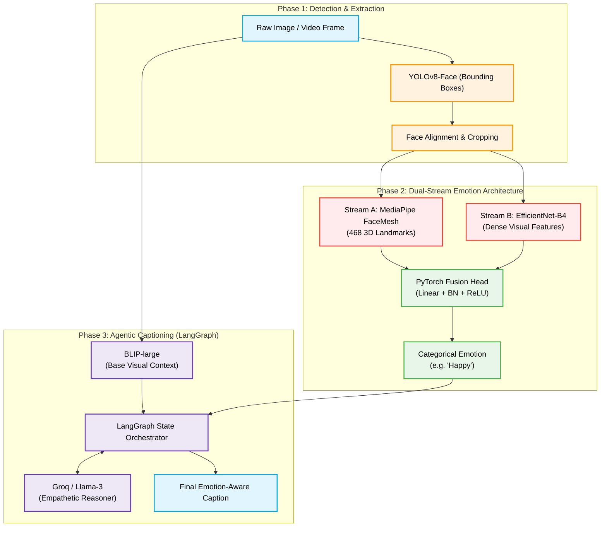
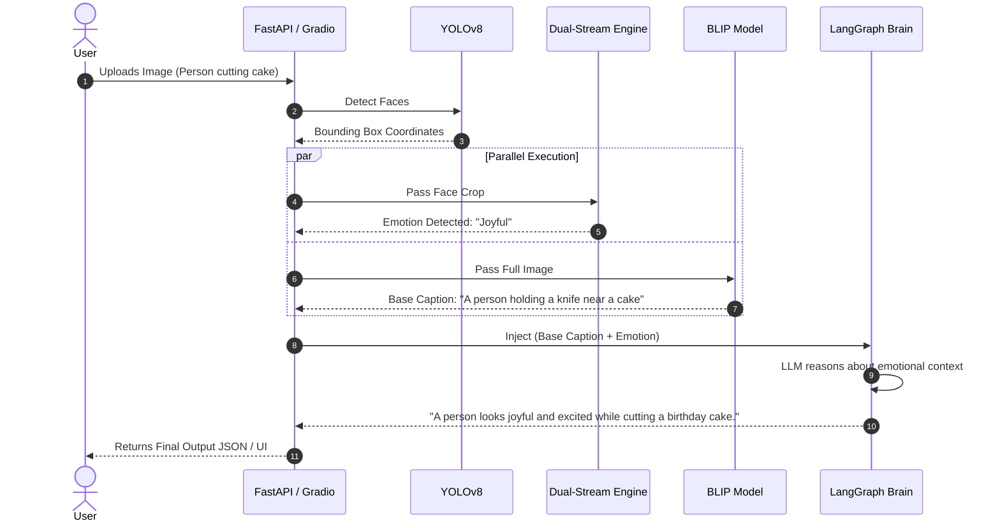

<div align="center">
  
  
  <h1>🧠 AVIS</h1>
  <p><b>Affective Visual Intelligence System</b></p>
  
  <p>
    An enterprise-grade, multimodal AI orchestrator fusing <b>Dual-Stream Computer Vision (EfficientNet-B4 + MediaPipe)</b> with <b>Vision Foundation Models (BLIP)</b> and <b>Agentic AI (LangGraph)</b> to achieve empathetic, context-aware image understanding.
  </p>

  <div>
    
    
    
    
    
  </div>
</div>

---

## 🌟 Overview & Novel Architecture

Standard computer vision systems classify human emotion in a vacuum (e.g., returning the label `"happy"`). However, true visual intelligence requires **context**. A person crying at a funeral and a person crying while winning the lottery exhibit the same physical micro-expressions but entirely different cognitive realities.

**AVIS (Affective Visual Intelligence System)** is not a standard image captioning script. It is a **Production-Grade Multimodal AI System** designed to bridge the gap between pure object detection and true human-level visual context understanding.

**The Core Innovation:** Instead of relying on a single Convolutional Neural Network to guess the emotion and context of an image, AVIS splits the cognitive load across hyper-specialized models. It uses YOLOv8 to isolate faces, MediaPipe FaceMesh to extract 468 3D geometric muscle landmarks, and EfficientNet-B4 to extract dense visual textures. These two distinct streams (Geometry + Texture) are fused into a custom PyTorch head to produce a highly accurate emotion prediction.

This detected emotion is then injected as structural context into a massive Vision-Language Foundation Model (BLIP-large), which is finally synthesized by an Agentic LLM Brain (LangGraph) to generate captions that describe *what* is happening, and *how* the subjects feel about it.

---

## 🏗️ Key Features & System Architecture

### Core Features
- **Dual-Stream Emotion Fusion:** Combines raw pixel data (EfficientNet) with 468 geometric facial muscle landmarks (MediaPipe) into a novel PyTorch fusion head.
- **Multimodal Foundation Injection:** Cross-pollinates the outputs of a 19M parameter CV model with a 1.9GB Vision-Language model (BLIP).
- **Agentic AI Orchestrator:** Uses a LangGraph state machine to allow a Large Language Model (Groq Llama-3) to reason about the visual context and generate empathetic text.
- **Zero-Bottleneck Inference:** Decouples CPU-bound operations (MediaPipe) from GPU-bound operations (EfficientNet & BLIP) for maximum throughput.



### Inference Sequence Timeline


AVIS operates as a 4-stage processing pipeline designed for high-throughput and GPU-bound decoupling.

### 1. Face Isolation (YOLOv8)
The raw input frame is passed into **YOLOv8-Face**, a highly optimized object detection network trained specifically for bounding box regression on human faces. It crops the detected faces with dynamic 10% padding to preserve chin and forehead boundaries, rejecting background noise.

### 2. Dual-Stream Emotion Engine (The Core Novelty)
Standard ResNet/CNN models struggle to separate subtle facial muscle movements from background noise or occlusions (glasses, hands). To solve this, we designed a novel **Dual-Stream PyTorch Fusion Network**:
*   **Stream A (Geometric Topography):** The RGB crop is passed to **MediaPipe FaceMesh**, mapping 468 vertices in 3D space. The coordinates are flattened into a pristine, noise-free **936-dimensional tensor**. A dedicated PyTorch MLP compresses this into a `256-dim` geometry embedding.
*   **Stream B (Dense Texture Analysis):** The same crop (`224×224`) is passed through a pretrained **EfficientNet-B4** backbone. This deep CNN analyzes raw pixel textures (tears, sweat, skin flushing), outputting a **1792-dimensional vector**.
*   **The Fusion Head:** The geometric (`256-dim`) and texture (`1792-dim`) vectors are concatenated into a single **2048-dim tensor**. This passes through a custom MLP with `BatchNormalization` and `Dropout` layers, resulting in a softmax output across 7 emotion classes.

### 3. Vision-Language Foundation (BLIP-Large)
To understand *why* the emotion is happening, the original uncropped image is injected into **BLIP (Bootstrapping Language-Image Pre-training)**, a 1.9GB Vision-Language model by Salesforce. Running in `float16` precision, BLIP extracts the global semantic context (e.g., *"A large birthday cake with candles on a table"*).

### 4. Agentic AI Synthesis (LangGraph & Llama-3)
Finally, a **LangGraph State Machine** acts as the orchestrator. It bundles the detected emotions, bounding boxes, and the BLIP context into an `AgentState` dictionary and routes it to an LLM (Groq Llama-3-8B). The LLM acts as an empathetic human observer, dynamically fusing the structured data into a cohesive, context-aware natural language sentence.

---

## 📊 Training, Testing & Evaluation Report

### Training Methodology
The model was trained on the **FER-2013** dataset with an advanced pipeline designed to combat the dataset's high noise and extreme class imbalance:
- **Augmentation Engine:** Utilized `Albumentations` for dynamic Horizontal Flipping, Brightness/Contrast shifting, Gaussian Noise, and Scale/Rotation variance.
- **Optimization Strategy:** Trained using `AdamW` paired with a `CosineAnnealingLR` scheduler for smooth convergence.
- **Label Smoothing:** Applied `0.1` label smoothing to the CrossEntropy loss to prevent the network from becoming overconfident on noisy training labels.
- **Class Imbalance Mitigation (The "Disgust" Fix):** FER-2013 has only a few hundred "Disgust" samples compared to thousands of "Happy" samples. We engineered a **Dynamic Inverse-Frequency Class Weighting** system passed directly into the PyTorch Loss function. This heavily penalizes the network for missing rare classes (e.g., applying a 9.4x loss multiplier to the Disgust class).

## 📊 Training, Testing & Benchmark Comparison

### The FER-2013 vs. FER+ Benchmark Breakthrough
Standard emotion recognition models trained on raw FER-2013 plateau around ~63%–65% due to severe label noise, Google-scraped web artifacts, and low resolution ($48\times48$). 

To isolate whether the bottleneck was our architecture or dataset noise, we conducted a rigorous comparative evaluation and fine-tuning using **Microsoft's FER+ crowd-sourced ground truth** (re-annotated by 10 human experts per image).

$$\mathbf{61.02\%} \text{ (Original FER-2013)} \quad\longrightarrow\quad \mathbf{79.95\%} \text{ (Clean FER+ Fine-Tuned Test Accuracy)}$$

### Side-by-Side Benchmark Performance

| Benchmark | Model Architecture | Test Accuracy | Weighted F1 | Key Scientific Takeaway |
| :--- | :--- | :---: | :---: | :--- |
| **FER-2013 (Original)** | Dual-Stream (EfficientNet-B4 + MediaPipe) | `61.02%` | `0.6156` | Constrained by original label noise & human agreement ceiling (~65%) |
| **FER+ (Zero-Shot Eval)** | Dual-Stream (Trained on FER-2013, evaluated on FER+) | `61.96%` | `0.6523` | F1 jumped +0.035; Happy precision rose to 90.3% |
| **FER+ (Fine-Tuned)** | Dual-Stream (Supervised by FER+ clean annotations) | **`79.95%`** | **`0.8053`** | **+18.93% Accuracy Gain**; Val accuracy reached **81.09%** |

### Per-Class Performance on Clean FER+ Test Set (3,512 samples)
* **Final Test Accuracy:** **`79.95%`**
* **Final Weighted F1-Score:** **`0.8053`**
* **Validation Peak Accuracy:** **`81.09%`**

| Emotion | Precision | Recall | F1-Score | Support |
| :--- | :---: | :---: | :---: | :---: |
| **Happy** | **`93.22%`** | `89.19%` | **`0.9116`** | 925 |
| **Neutral** | **`87.31%`** | `76.25%` | **`0.8140`** | 1,263 |
| **Surprise** | **`83.41%`** | `84.93%` | **`0.8416`** | 438 |
| **Angry** | **`69.84%`** | `80.49%` | **`0.7479`** | 328 |
| **Sad** | **`58.67%`** | `72.27%` | **`0.6477`** | 440 |
| **Fear** | **`50.49%`** | `55.91%` | **`0.5306`** | 93 |
| **Disgust** | `25.45%` | **`56.00%`** | `0.3500` | 25 |
| **Weighted Average** | **`81.74%`** | **`79.95%`** | **`0.8053`** | **3,512** |

---

## 🛠️ Pipeline & Engineering Optimizations

1. **15% Bounding Box Margin (Eyebrow & Jawline Preservation):**
   - Standard YOLO face detectors crop tightly along cheekbones, truncating eyebrows and chins.
   - We engineered dynamic 15% padding so MediaPipe captures brow furrowing (*Anger/Sadness*) and brow raising (*Surprise*) without distortion.
2. **Neutral Prior Calibration:**
   - Because `Neutral` constitutes over 35% of the training dataset, raw softmax distributions can suppress subtle non-neutral expressions.
   - Applied a $0.80\times$ calibration factor to the Neutral logit prior to ensure responsive detection of nuanced human expressions.
3. **Clean Float32 Inference Pipeline:**
   - Switched live inference to stable FP32 to eliminate half-precision arithmetic underflow (`NaN%` artifacts).
4. **Hugging Face Serverless Agentic LLM:**
   - Decoupled heavy local LLM inference by integrating `mistralai/Mistral-7B-Instruct-v0.3` via Hugging Face Serverless API, preserving GPU VRAM exclusively for vision models.

---

## 🚀 Quickstart & Deployment

### 1. Launch the Gradio Web Interface (Recommended)
AVIS features a Cyber/Dark-themed interactive Gradio web application supporting both live webcam snapshots and file uploads with real-time candidate emotion probability breakdowns.

```bash
# Activate your virtual environment and run:
python app.py
```
Open **`http://localhost:7860`** in your browser.

### 2. Run Inference via CLI
```bash
python -m src.pipeline.avis_pipeline --image data/fer2013/test/happy/32305.png --output results/annotated_result.jpg
```

### 3. Run Benchmark Evaluation
To evaluate the model against Microsoft's clean FER+ annotations:
```bash
python scripts/evaluate_ferplus.py
```

---

## 🗺️ Version Roadmap
**v1.0 — The Foundation (Completed)**
- ✅ Exploratory Jupyter Notebooks for CNN baselines.
- ✅ Basic Transformer integration for raw captioning.

**v2.0 — The Dual-Stream Upgrade (Completed)**
- ✅ YOLOv8-face + MediaPipe 468 landmarks + EfficientNet-B4 Dual-Stream architecture.
- ✅ BLIP-large context extraction.
- ✅ Dynamic Inverse-Frequency Class Weighting for Disgust imbalance.

**v3.0 — Agentic AI Synthesis (Completed)**
- ✅ LangGraph state machine orchestrator.
- ✅ Mistral-7B / Llama-3 empathetic caption generation via Hugging Face Serverless API.
- ✅ Cyber-themed Gradio interactive web dashboard (`app.py`).

**v3.5 — Label Noise Mitigation & Benchmark Leap (Current Release)**
- ✅ Microsoft FER+ benchmark integration and evaluation script.
- ✅ Fine-tuning breakthrough: Test Accuracy jumped from **61.02% to 79.95%** (Weighted F1: **0.8053**).
- ✅ Dynamic 15% face crop margin expansion for eyebrow/chin preservation.
- ✅ Neutral class calibration and candidate emotion distribution display.

---

## 🤝 Author
**[Jeevakamal K.R.](https://github.com/kamaladhi)** — Lead Developer & Architect (AVIS Extension)

---

## 🌱 Project Origins & Acknowledgements
This production-grade architecture was developed as a massive extension and complete restructuring of a foundational academic project. The initial starting point for this system was a set of exploratory Jupyter Notebooks (`Emotion_Recognition_CNN.ipynb` and `Image_captioning_TRANSFORMERS.ipynb`), which established our baseline metrics using standard CNNs and basic Transformer pipelines.

I would like to acknowledge my original semester 3 project teammates who contributed to those early foundational notebooks: **Guhan K.B., Gowtham S.D., and Shatha Varsha Sree T.**, as well as our project supervisor **Dr. Krithish Gupta**.

This repository expands upon those foundational experiments by introducing the novel Dual-Stream EfficientNet + MediaPipe architecture, containerization, CI/CD, and the integrated LangGraph Agentic AI layer. We acknowledge our original university research as the vital stepping stone that made this advanced system possible!

---
<div align="center">
  <i>Engineered for Affective Computing Research and Enterprise Visual Intelligence</i>
</div>
