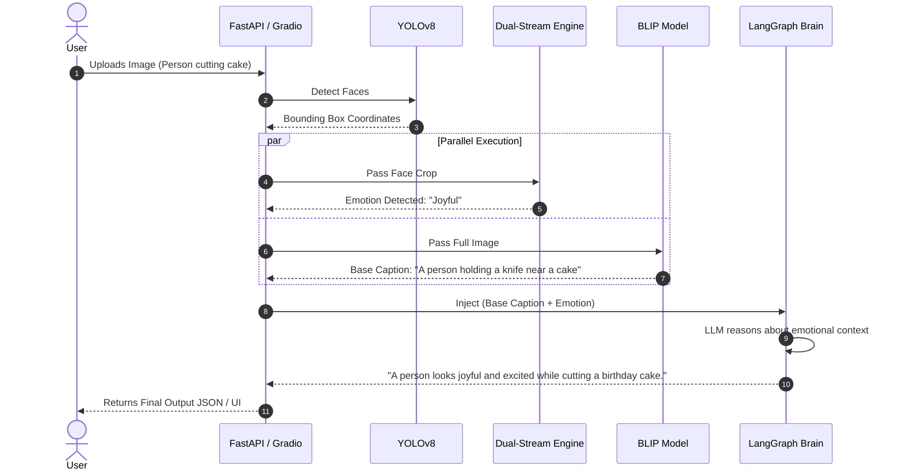

# 🧠 AVIS — Dual-Stream Emotion Recognition & Contextual Image Captioning

> An enterprise-grade multimodal AI orchestrator that fuses dual-stream computer vision architectures (EfficientNet + MediaPipe) with Vision Foundation Models (BLIP) and Agentic AI to deliver highly contextual, empathetic, and emotion-aware image captions.

[](#)
[](#)
[](#)
[](#)
[](LICENSE)

---

## 🌟 Overview & Novel Architecture

AVIS (Affective Visual Intelligence System) is not a standard image captioning script. It is a **Production-Grade Multimodal AI System** designed to bridge the gap between pure object detection and true human-level visual context understanding.

**The Core Innovation:**
Instead of relying on a single Convolutional Neural Network to guess the emotion and context of an image, AVIS splits the cognitive load across hyper-specialized models. It uses **YOLOv8** to isolate faces, **MediaPipe FaceMesh** to extract 468 3D geometric muscle landmarks, and **EfficientNet-B4** to extract dense visual textures. These two distinct streams (Geometry + Texture) are fused into a custom PyTorch head to produce a highly accurate emotion prediction. 

This detected emotion is then injected as structural context into a massive Vision-Language Foundation Model (**BLIP-large**), which is finally synthesized by an **Agentic LLM Brain (LangGraph)** to generate captions that describe *what* is happening, and *how* the subjects feel about it.

---

## 🏗️ Key Features & System Architecture

### Core Features
- **Dual-Stream Emotion Fusion** — Combines raw pixel data (EfficientNet) with 468 geometric facial muscle landmarks (MediaPipe) into a novel PyTorch fusion head.
- **Multimodal Foundation Injection** — Cross-pollinates the outputs of a 19M parameter CV model with a 1.9GB Vision-Language model (BLIP).
- **Agentic AI Orchestrator (Phase 3)** — Uses a LangGraph state machine to allow a Large Language Model (Groq Llama-3) to reason about the visual context and generate empathetic text.
- **Zero-Bottleneck Inference** — Decouples CPU-bound operations (MediaPipe) from GPU-bound operations (EfficientNet & BLIP) for maximum throughput.

### System Architecture Flow

```mermaid
graph TD
    %% Styling Class Definitions
    classDef client fill:#e1f5fe,stroke:#03a9f4,stroke-width:2px,color:#000;
    classDef detection fill:#fff3e0,stroke:#ff9800,stroke-width:2px,color:#000;
    classDef stream fill:#ffebee,stroke:#f44336,stroke-width:2px,color:#000;
    classDef fusion fill:#e8f5e9,stroke:#4caf50,stroke-width:2px,color:#000;
    classDef llm fill:#ede7f6,stroke:#673ab7,stroke-width:2px,color:#000;
    
    ImageInput["Raw Image / Video Frame"]:::client

    subgraph Phase1["Phase 1: Detection & Extraction"]
        YOLO["YOLOv8-Face (Bounding Boxes)"]:::detection
        Cropper["Face Alignment & Cropping"]:::detection
        
        ImageInput --> YOLO --> Cropper
    end

    subgraph Phase2["Phase 2: Dual-Stream Emotion Architecture"]
        direction LR
        StreamA["Stream A: MediaPipe FaceMesh<br>(468 3D Landmarks)"]:::stream
        StreamB["Stream B: EfficientNet-B4<br>(Dense Visual Features)"]:::stream
        FusionHead["PyTorch Fusion Head<br>(Linear + BN + ReLU)"]:::fusion
        EmotionOutput["Categorical Emotion<br>(e.g. 'Happy')"]:::fusion
        
        Cropper --> StreamA
        Cropper --> StreamB
        StreamA --> FusionHead
        StreamB --> FusionHead
        FusionHead --> EmotionOutput
    end

    subgraph Phase3["Phase 3: Agentic Captioning (LangGraph)"]
        BLIP["BLIP-large<br>(Base Visual Context)"]:::llm
        LangGraph["LangGraph State Orchestrator"]:::llm
        Groq["Groq / Llama-3<br>(Empathetic Reasoner)"]:::llm
        FinalCaption["Final Emotion-Aware Caption"]:::client
        
        ImageInput --> BLIP
        BLIP --> LangGraph
        EmotionOutput --> LangGraph
        LangGraph <--> Groq
        LangGraph --> FinalCaption
    end
```



### Inference Sequence Timeline



---

## 🔬 Methodology & Module Deep-Dives

### 1. Multi-Face Detection & Normalization (YOLOv8)
Before emotion can be analyzed, the system must accurately isolate faces from complex backgrounds. We utilize **YOLOv8-Face**, trained specifically for high-speed bounding box regression. 
- The image is ingested and passed through the YOLO detector, which identifies all faces in the frame.
- Each face is cropped with a dynamic 10% padding boundary to ensure the chin and forehead are preserved.
- The crops are converted to Grayscale and resized to `48x48` for the CNN, while the original RGB crop is passed to MediaPipe.

### 2. The Dual-Stream Emotion Fusion Engine (The Core Novelty)
Most classical emotion recognition systems (like standard ResNets) rely purely on Convolutional Neural Networks (CNNs). However, CNNs struggle to isolate subtle micro-expressions (like a slight eyebrow raise) from background noise (like glasses or shadows). To solve this, AVIS splits the cognitive load into two streams:

- **Stream A (Geometric Topography):** The RGB crop is passed to **MediaPipe FaceMesh**, which mathematically maps 468 vertices onto the face in 3D space. We extract the `(x, y)` coordinates of these landmarks and flatten them into a pure, noise-free **936-dimensional tensor**. This gives the network the exact structural layout of the facial muscles.
- **Stream B (Dense Texture Analysis):** Simultaneously, the `48x48` grayscale crop is passed through **EfficientNet-B4**. This deep CNN acts as a feature extractor, analyzing the raw pixels to detect subtle textures like tears, sweat, skin flushing, and pupil dilation, outputting a **1792-dimensional feature vector**.
- **The PyTorch Fusion Head:** The `936-dim` geometry vector and the `1792-dim` texture vector are concatenated into a massive `2728-dim` tensor. This tensor is passed through a custom Multi-Layer Perceptron (MLP) utilizing `BatchNormalization` (to prevent vanishing gradients) and `Dropout` (for regularization), culminating in a Softmax output that distributes confidence percentages across 8 distinct emotion classes.

### 3. Vision-Language Context Extraction (BLIP)
Knowing that a person is "Happy" is useless if we don't know *why* they are happy. To solve this, the *original uncropped* image is passed into **BLIP-large (Bootstrapping Language-Image Pre-training)**, a 1.9GB Foundation Model by Salesforce. 
- BLIP acts as the "eyes" for the background environment. 
- It bypasses standard rigid encoder-decoders by leveraging massive pre-training, generating a highly accurate base context (e.g., *"A living room with a birthday cake"*).

### 4. Agentic AI Layer (LangGraph)
*Currently in development.* The final stage is synthesizing the disparate data points. Instead of naive string concatenation (e.g., `"A happy person " + "cutting a cake"`), AVIS acts as an intelligent agent.
- The system builds a **LangGraph State Machine**. The State dictionary holds the BLIP base caption, the detected emotions, and the bounding box coordinates.
- This state is injected into a **Large Language Model (Groq Llama-3)** via a carefully engineered System Prompt.
- The LLM acts as an empathetic human observer, dynamically rewriting the data into a single, cohesive, context-aware sentence that sounds entirely natural.

---

## ⚙️ Technology Stack

- **Deep Learning:** PyTorch, Torchvision, Albumentations
- **Computer Vision:** YOLOv8, MediaPipe FaceMesh, OpenCV
- **Foundation Models:** HuggingFace Transformers, BLIP-large, EfficientNet-B4
- **Agentic AI:** LangChain, LangGraph, Groq API (Llama-3)
- **Deployment:** FastAPI, Gradio, Docker, Docker Compose
- **Tracking:** MLflow, tqdm

---

## 📂 Detailed Directory Structure

```text
AVIS-Dual-Stream-Emotion-Recognition/
├── data/                            # FER-2013 & custom datasets
├── src/                             
│   ├── api/                         # FastAPI endpoints & schemas
│   ├── agents/                      # Phase 3: LangGraph AI Orchestrator
│   │   ├── caption_agent.py         
│   │   └── state.py                 
│   ├── captioning/                  # BLIP Vision-Language Wrapper
│   ├── detection/                   # YOLOv8 & MediaPipe extractors
│   ├── emotion/                     # PyTorch training, model & infer loops
│   ├── fusion/                      # Dual-stream PyTorch fusion heads
│   ├── pipeline/                    # Unified end-to-end inference router
│   └── utils/                       # Configs, MLflow logger, Visualizers
├── demo/                            # Gradio Web UI (Real-time webcam)
├── scripts/                         # Dataset ingest & model downloaders
├── tests/                           # Pytest unit tests
├── Dockerfile                       
├── docker-compose.yml               
└── requirements.txt
```

---

## 📝 Things To Be Done (Current Working Stage)

### High Priority (Currently Working On)
- ✅ **Phase 1: Architecture Scaling:** Upgrade from EfficientNet-B0 to EfficientNet-B4 for higher density feature extraction.
- ✅ **Phase 2: Training Infrastructure:** Implement `tqdm` progress monitoring and robust checkpoint saving mechanics during the 50-epoch GPU training run.
- ⏳ **Phase 3: LangGraph Agentic Layer:** Build `src/agents/caption_agent.py` to route BLIP + Emotion outputs to the Groq LLM API.
- ⏳ **Live Webcam Integration:** Hook the dual-stream inference pipeline into the Gradio UI for real-time video processing.

### Medium Priority
- [ ] **Class Imbalance Mitigation:** Implement dynamic Class Weights in `train.py` to handle the heavy imbalance of the 'Disgust' class in FER-2013.
- [ ] **ONNX Export:** Quantize and export the PyTorch model to ONNX for CPU-optimized inference.
- [ ] **Multi-Face Batching:** Optimize the pipeline to process multiple cropped faces in a single GPU batch rather than sequentially.

---

## 🗺️ Version Roadmap

### v1.0 — The Foundation (Completed)
- ✅ Exploratory Jupyter Notebooks for CNN baselines.
- ✅ Basic Transformer integration for raw captioning.

### v2.0 — The Dual-Stream Upgrade (Current Release)
- ✅ Object-Oriented modular repository structure.
- ✅ YOLOv8 + MediaPipe + EfficientNet-B4 Dual-Stream architecture.
- ✅ BLIP-large context extraction.
- ✅ Dockerization & CI/CD Pipeline.

### v3.0 — The Agentic AI (Next Phase)
- 🔜 LangGraph state machine orchestrator.
- 🔜 Groq LLM empathetic caption synthesis.
- 🔜 Real-time asynchronous webcam inference.

---

## 🤝 Author

- **[Jeevakamal K.R.](https://github.com/kamaladhi)** — *Lead Developer & Architect (AVIS Extension)*

---

## 🌱 Project Origins & Acknowledgements

This production-grade architecture was developed as a massive extension and complete restructuring of a foundational academic project. The initial starting point for this system was a set of exploratory Jupyter Notebooks (`Emotion_Recognition_CNN.ipynb` and `Image_captioning_TRANSFORMERS.ipynb`), which established our baseline metrics using standard CNNs and basic Transformer pipelines. 

I would like to acknowledge my original semester 3 project teammates who contributed to those early foundational notebooks: **Guhan K.B., Gowtham S.D., and Shatha Varsha Sree T.**, as well as our project supervisor **Dr. Krithish Gupta**.

This repository expands upon those foundational experiments by introducing the novel **Dual-Stream EfficientNet + MediaPipe architecture**, containerization, CI/CD, and the forthcoming **LangGraph Agentic AI** layer. We acknowledge our original university research as the vital stepping stone that made this advanced system possible!

---

## 📄 License

MIT — see [LICENSE](LICENSE)
